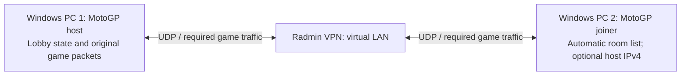

# LAN / Radmin VPN research — 14 October 2026

First target: **two Windows 10/11 PCs on the same Radmin VPN network, hosting
and joining a MotoGP 09/10 race without a separate directory/relay server**.
Radmin supplies the virtual LAN; the game host owns the lobby. The primary flow
is automatic room discovery, with direct host IPv4 entry as a fallback.
Internet matchmaking, NAT traversal,
ranked services, friends, voice and leaderboards are outside this first stage.

The research baseline was stability commit `bcef3c9`. The subsequent
[first lobby foundation](lan-lobby-preview.md) implements and checks native
discovery and guest session calls. The subsequent [experimental integration](lan-multiplayer-test.md)
wires guest XNet/UDP/VDP and launcher settings; real racing remains unverified. SDK
`0.10.0.24-dev.gbd833a2`, patched title version `0.0.1.1`.

## Existing ReXGlue examples

Public sources were checked at the revisions below. The projects document
multiplayer and contain implementations; their gameplay claims have not been
independently reproduced here with their game dumps.

| Project | Evidence and relevance |
|---|---|
| **DBZ Burst Limit Recompiled** | Explicit Radmin VPN/LAN instructions, host/join scripts, no lobby service in direct mode. Closest match to the requested user workflow. |
| **Real Steel / ReCompiledSteel** | Original Xbox Live session/peer code supplied with LAN/direct-address discovery. Source separates session advertisements, QoS and opaque game datagrams from its optional internet lobby. Useful model for real host metadata. |
| **Forza Horizon 1 ReImagined** | Virtual System Link UDP transport, peer address translation, guest-port multiplexing and asynchronous receives. Also offers a separate Forza Live server, which is not our initial target. |
| **Army of Two / Sierra Romeo** | Windows receive/session implementation and regression tests; authors qualify their validation as local two-process campaign connections, with second-machine/internet/full-campaign coverage pending. |
| **Rockstar Table Tennis / ttrecomp** | Documents System Link tested between macOS and PS5; explicitly says Windows hardware and full-match coverage are incomplete. Shows feasibility without proving our Windows/MotoGP case. |
| **FIFA Street / ReStreet** | Current v1.3 explicitly offline-only; its updater removes the older online patch. Do not present it as a currently working online reference. |
| **Call of Duty 3 Multiplayer recomp** | A multiplayer title/project description alone is insufficient evidence of functioning network play. |

### DBZ: the exact requested connection model

At revision `bb60bc1d6d76fab0c181de40b5929ac557170a27`:

- [README: older Radmin VPN/LAN method](https://github.com/iExplosiveRage/DBZ-Burst-Limit-Recompiled/blob/bb60bc1d6d76fab0c181de40b5929ac557170a27/README.md#older-method-radmin-vpn--lan)
- [Host script](https://github.com/iExplosiveRage/DBZ-Burst-Limit-Recompiled/blob/bb60bc1d6d76fab0c181de40b5929ac557170a27/scripts/Host_Online.bat)
- [Join script](https://github.com/iExplosiveRage/DBZ-Burst-Limit-Recompiled/blob/bb60bc1d6d76fab0c181de40b5929ac557170a27/scripts/Join_Online.bat)

The host supplies its Radmin IPv4; the joiner supplies its own IPv4 and the
host's. Their direct path uses `REX_XNET_IP`, `REX_XNET_SEARCH_IP` and optional
`REX_XNET_BIND_IP`, mapping guest UDP port 1000 to host port 59395. These are
**that project's** variables and port, not implemented MotoGP settings.

The useful SDK changes are on its **burstlimit branch**, not main. Reviewed
revision: `465f9ef502f96c3652b85daa223608920faf451a`:

- [XNet and receive/send](https://github.com/iExplosiveRage/rexglue-sdk/blob/465f9ef502f96c3652b85daa223608920faf451a/src/kernel/xam/xam_net.cpp)
- [Session and search](https://github.com/iExplosiveRage/rexglue-sdk/blob/465f9ef502f96c3652b85daa223608920faf451a/src/kernel/xam/apps/xgi_app.cpp)

It is not a drop-in replacement for our SDK. For example, the inspected direct
search injects one room from the configured host IP with game-specific layout,
fixed key material and slot assumptions; XNetConnect/GetConnectStatus remain
stubs in that fork. MotoGP imports both connection functions, so those omissions
must be addressed. Do not transplant DBZ's battle tick/input-delay patches or
its title-specific addresses into MotoGP.

### Transport and session models worth adapting

**Real Steel**, revision `bb6a241fb5be2fbca19a1762d699b72e5c9f8d29`:
[transport](https://github.com/tokeneffortports/ReCompiledSteel/blob/bb6a241fb5be2fbca19a1762d699b72e5c9f8d29/src/realsteel_netplay.cpp),
[online/session bridge](https://github.com/tokeneffortports/ReCompiledSteel/blob/bb6a241fb5be2fbca19a1762d699b72e5c9f8d29/src/realsteel_online.cpp).
Its transport advertises actual session ID/key, ports, slot counts and QoS
payload, then tunnels the original game's datagrams. LAN broadcasts and explicit
peer addresses work independently of its optional lobby server. This is a better
basis for MotoGP room data than fabricating a successful search result.

**Forza**, revision `2245149c65bdcc6dc7d1bf3007a64fcb64082d08`:
[net.cpp](https://github.com/Dyotson/ForzaHorizon1-ReImagined/blob/2245149c65bdcc6dc7d1bf3007a64fcb64082d08/forza-recomp/src/kernel/net.cpp).
The independent LAN path translates console secure addresses to real endpoints,
keeps guest ports separate from host ports, supports multiple local instances,
queues overlapped receives and falls back to SDK imports when its network mode
is disabled. Its service-specific Live and open-world code is outside our scope.

**Army of Two**, revision `47478417483b873f2061f7fa6d7cc150c738767d`:
[receive implementation](https://github.com/Raftacon/sierra-romeo-ao2-pc-port/blob/47478417483b873f2061f7fa6d7cc150c738767d/src/network_receive.cpp),
[kernel tests](https://github.com/Raftacon/sierra-romeo-ao2-pc-port/blob/47478417483b873f2061f7fa6d7cc150c738767d/tests/network_kernel.cpp).
Useful behavior references include pending/completed operations, length/output
validation, event signalling and socket-close cancellation. This project's
GPL-3 source is not copied into our implementation by default. DBZ's SDK retains
BSD notices; Forza's project has an MIT license. Preserve applicable notices if
source is subsequently adapted. No external source has been committed here.

**Xenia Canary Netplay** is an additional Xbox API reference, rather than a
ReXGlue port:
[implementation](https://github.com/AdrianCassar/xenia-canary),
[System Link documentation](https://github.com/AdrianCassar/xenia-canary/wiki/Systemlink).
Its web-service architecture is not required for the first Radmin stage.

FIFA Street's offline status is recorded in
[README](https://github.com/samuelit0davila/fifa-street-pc-port/blob/df5f8efa4152dd0c94fe05c5121dbd1ac37b464b/README.md)
and [changelog](https://github.com/samuelit0davila/fifa-street-pc-port/blob/df5f8efa4152dd0c94fe05c5121dbd1ac37b464b/CHANGELOG.md).

## MotoGP and the current SDK

Static inspection of the generated **TU 0.0.1.1** code found direct calls to
**25 NetDll imports** and **16 distinct XGI message IDs** in constant setup
sequences. These show available code paths, not runtime proof that every path
executes during an unranked race.

| Title wrapper / call | Pinned SDK behavior / required work |
|---|---|
| `0x825D93F0` → WSARecvFrom | Always returns -1; receives must post/complete the original buffers correctly. |
| `0x825D93B8` → WSAGetOverlappedResult | Stub; needs pending/completed/failed results and correct byte/flag outputs. |
| `0x825D9460` → WSASendTo | Does not support overlapped completion, ignores send failure/byte output; needs actual send semantics. |
| `0x825D9180` → XNetXnAddrToInAddr | Returns failure; needs stable guest address ↔ endpoint translation. |
| `0x825D9198` / `0x825D91A8` → XNetConnect / GetConnectStatus | Stubs; the stub macro only logs and leaves r3 unchanged. Supply a meaningful connection state. |
| `0x825D9248` → XNetGetTitleXnAddr | Reports loopback and a fixed MAC. Advertise the selected Radmin endpoint and per-instance identity. |
| `0x825D91B8` / `0x825D91D8` → QoS listen / lookup | Failing or stubbed; exchange real host lobby/QoS payload and complete requests. |
| `0x825D9668` → session create | Fake handle/object pointers, no actual session storage or output. Replace with real lifetime-managed state. |
| `0x825D98C8`, `0x825D9978` → join; `0x825D9A28`, `0x825D9AD0` → leave | Route through XGI; current SDK mostly logs and returns success. Maintain real membership/slots. |
| `0x825D9DA8` → search-ex (`0xB001C`) | No populated results; query the configured host and produce validated session data. |
| `0x825D9C58` / `0x825D9CF8` → start/end | Maintain lobby/race lifecycle and cleanup. |

Other identified messages include properties/context (`0xB0006/7`), details
(`0xB001D`), arbitration (`0xB001A`) and search-by-ID (`0xB001B`). Trace the actual
Player Match path before deciding which extra messages are necessary. Ranked
statistics and achievements are not acceptance criteria for this stage.

Pinned upstream source references:

- [xam_net.cpp](https://github.com/rexglue/rexglue-sdk/blob/bd833a2ab69d305f99ddf57418fc38ffec8af93d/src/kernel/xam/xam_net.cpp)
- [xgi_app.cpp](https://github.com/rexglue/rexglue-sdk/blob/bd833a2ab69d305f99ddf57418fc38ffec8af93d/src/kernel/xam/apps/xgi_app.cpp)
- [xam_user.cpp](https://github.com/rexglue/rexglue-sdk/blob/bd833a2ab69d305f99ddf57418fc38ffec8af93d/src/kernel/xam/xam_user.cpp)
- [user_profile.h](https://github.com/rexglue/rexglue-sdk/blob/bd833a2ab69d305f99ddf57418fc38ffec8af93d/include/rex/system/xam/user_profile.h)
- [xsocket.cpp](https://github.com/rexglue/rexglue-sdk/blob/bd833a2ab69d305f99ddf57418fc38ffec8af93d/src/system/xsocket.cpp)

Basic host TCP/UDP socket plumbing exists, but this is insufficient for the
session/async layer. The profile reports local sign-in, denies privileges, and
uses the same default XUID on every machine. LAN needs explicit local multiplayer
identity/admission behavior while retaining existing offline save ownership.
Changing the saved profile's global XUID indiscriminately is not acceptable.

**Receive ABI:** the title's wrapper forwards an additional stack argument;
Forza's receive wrapper explicitly handles from-length, overlapped and completion
separately. The current SDK typed WSARecvFrom handler omits the from-length
parameter. Verify the exact MotoGP PPC register/stack contract before implementing
it; copying the DBZ handler unchanged would be unsafe for this title.

Native System Link has **not** been established for MotoGP. Unlike a confirmed
System Link example, its import inventory does not include Ethernet-link/system-
link-port helpers. This is not proof of absence, but we should plan to supply a
LAN backend beneath its existing Xbox Live Player Match flow.

## Implementation route

1. **Instrument the original flow and settle the ABI.** Add an opt-in trace for
   networking, XGI messages, sign-in/privilege gates and overlapped operations.
   Record sizes, state transitions and failures, rate-limit polling logs. Keep
   ordinary single-player behavior as the default and keep the pinned SDK.
2. **Build the receive/transport foundation.** Validate buffers/endian handling,
   pending requests, completion events, send errors and close/cancel lifetime.
   Test Windows PE processes communicating over loopback before game lobbies.
3. **Create a LAN lobby with discovery and direct-IP fallback.** Detect the local
   Radmin adapter/address automatically. Hosts answer discovery queries with real
   session metadata; searches populate the game's existing room-results flow.
   Selecting a room joins its advertised endpoint without typing an IP.
   An optional host IPv4 uses the same metadata query and join protocol by unicast
   when broadcast discovery is unavailable. Implement required XNet mapping,
   connect state, QoS, create/search/join/leave and selected local identities.
   Reject incompatible game/build versions and return no room when a host is
   absent, rather than advertising a fabricated session.
4. **Connect two actual game instances.** Start with two-player, unranked Player
   Match: lobby, bike/track agreement, race start, peer motion, finish, return to
   lobby, disconnect, timeout and reconnect. Preserve the original game's
   network payload and simulation timing; DBZ fighting-game timing patches do
   not transfer to a racing game.
5. **Package controls and test Radmin.** Keep room discovery as the normal path,
   with an optional “Connect by IP” action and adapter override in EN/TR controls.
   Radmin's local IPv4 is obtained from the adapter, not required as routine user
   input. Keep its address instead of advertising the physical Wi-Fi IP.
   Windows app firewall access must allow the selected interface/UDP traffic.
6. **Add larger grids later.** Higher player counts and internet services follow
   the two-player path. Discovery and direct-IP fallback are both first-stage
   requirements, rather than deferring discovery to this later stage.

### Discovery behavior and acceptance

Search sends small UDP discovery requests on the selected Radmin interface;
listening hosts respond with their actual join endpoint, session ID, build/title
version, name, slots and applicable game properties. Deduplicate repeated replies
by session ID and endpoint, expire entries that stop answering, and hide or mark
closed/incompatible rooms. Refreshing the list must not block the game/UI thread.

Direct-IP fallback sends the same request to an explicit endpoint and retains
compatibility checks and timeouts. It does not bypass admission or manufacture a
room entry when the host does not answer. No public directory service is involved.

Radmin/Windows broadcast forwarding, routing and adapter changes need real-device
validation. Automatic discovery is implementable, but its success on a particular
VPN installation cannot be established from loopback tests alone. If discovery
packets do not reach peers, direct unicast IP remains available.

No additional Python/server program is planned for players in this first design.
The hosting game contains the small session/transport service. Radmin credentials
and VPN membership remain managed by Radmin, outside the launcher.

## What can be tested while the user has no PC access

Separate Windows/Wine processes can validate guest ABI, two-way UDP, real session
buffers, pending/complete/cancel states, timeouts, unique identities, version
rejection and unchanged offline defaults. Discovery fixtures additionally cover
multiple hosts, duplicate replies, stale/closed rooms, incompatible builds and
unicast fallback with broadcasts deliberately unavailable. Packet loss/delay
fixtures can exercise transport cleanup. These do not establish real Radmin adapter behavior, native
Windows GPU races, full-grid synchronization or long-session reliability.

Acceptance for the first implementation milestone includes a real two-process
lobby discovered without entering the host's IP, successful join and safe cleanup,
plus a working direct-IP fallback when discovery is unavailable. Actual Radmin
adapter discovery remains a separate Windows-device acceptance check. A successful
UDP echo, enabled menu or success-returning stub alone does not meet it.

Research evidence and downloaded references are under ignored `out/lan-research/`;
original game files and external source code are not published. No other game's
binary or assets were downloaded to conduct this research.
