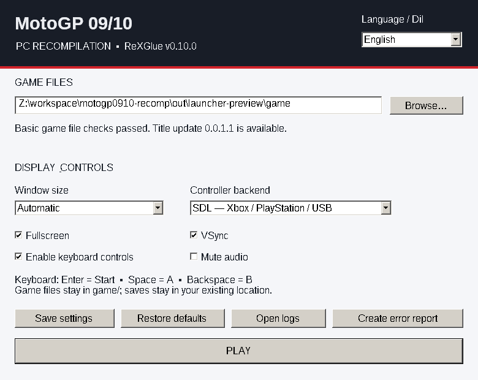
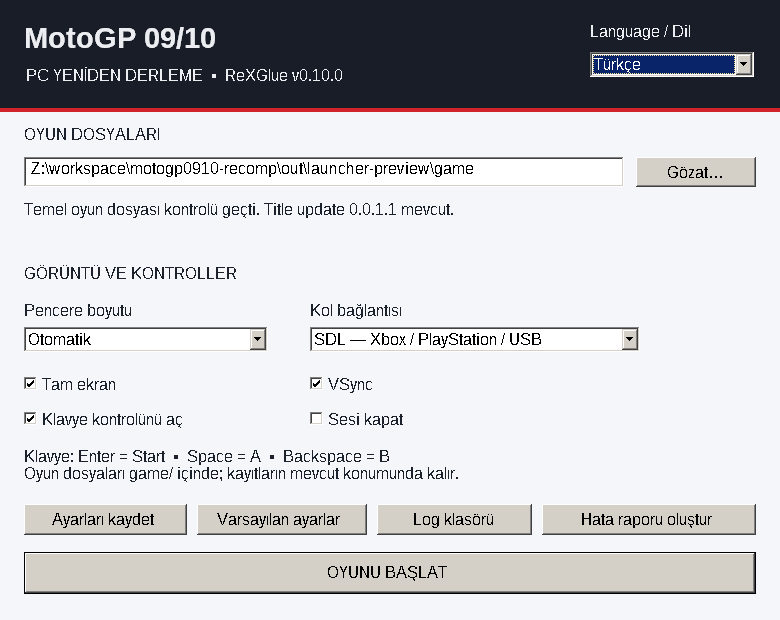

# Windows launcher — first release

[Windows launcher + game package](https://github.com/inflamesgo/motogp0910-recomp/blob/main/downloads/MotoGP0910-Windows-x64-launcher.zip)

GitHub'da **Download raw file** ile indir; mevcut program klasörüne çıkar.
EXE/DLL'leri güncelle, oyun verilerini `game/` altında tut. Mevcut ayar/kayıt
ve oyun dosyalarını silme. `motogp0910-launcher.exe`yi aç ve **PLAY**'e bas.
`motogp0910.exe` ile doğrudan açılış da devam eder.

Varsayılan arayüz İngilizcedir. Üstteki **Language / Dil** menüsünden **Türkçe**
seçilir; dil anında değişir ve `motogp0910-launcher.toml` dosyasında saklanır.

## Controls

- **Browse / Gözat:** `default.xex` içeren oyun klasörünü seçer. Varsayılan
  seçim EXE yanındaki `game/`, eski düz yerleşim ise fallback'tir. Klasör yolunu
  elle yazmak da mümkündür.
- **Window size / Pencere boyutu:** otomatik veya 720p–4K pencere boyutları.
  Bu seçenek SDK'nın `window_width`/`window_height` değerlerini kullanır;
  dahili GPU render ölçeği değildir.
- **Fullscreen, VSync, keyboard, mute:** mevcut SDK seçeneklerini kullanır.
- **Controller backend:** SDL veya XInput. Kullanıcının verdiği
  `gamecontrollerdb.txt` EXE yanında paketlenir ve SDL tarafından kullanılır.
- **Save settings / Ayarları kaydet:** seçenekleri `motogp0910.toml` içine
  kaydeder. PLAY de başlatmadan önce ayarları kaydeder.
- **Restore defaults / Varsayılan ayarlar:** launcher'ın yönettiği seçenekleri
  varsayılan değerlere döndürür; uygulamak için kaydet veya PLAY'e bas.
- **Open logs / Log klasörü:** EXE yanındaki `logs/` klasörünü açar.
- **Create error report / Hata raporu oluştur:** `logs/report-.../` altında
  yönetilen ayarlar, temel dosya kontrolü ve en yeni üç logun son parçalarını
  toplar. Her log için en fazla 2 MiB alınır. Rapor hiçbir yere gönderilmez.

Oyun çalışırken ikinci PLAY engellenir. Launcher kapatılırsa oyun çalışmaya
devam eder. Oyun çıkış kodu gösterilir ve yeniden başlatılabilir.

## Settings and files

Mevcut TOML dosyası gerçek toml++ parser'ıyla okunur. Launcher'ın yönetmediği
anahtarların/tablo/array değerleri ve özel tuş eşlemeleri korunur. TOML yeniden
biçimlendirilir; yorumların ve önceki biçimin byte olarak aynısı ilk kayıtta
`motogp0910.toml.bak` içinde korunur. Var olan yedek yeniden yazılmaz.

Ayarlar geçici dosyaya yazılıp atomik olarak değiştirilir. Hatalı TOML, başka
bir programın değiştirdiği ayarlar veya kaydetme başarısızlığı mevcut dosyayı
sessizce ezmez. Açık özel kayıt/cache yolları oyuna iletilir; yeni kayıt konumu
oluşturmak için bir override verilmez. Seçilen oyun yolu CLI ile iletilir;
SDK'nın config yüklemesinden önce yapılan yol çözümlemesinde de geçerli olur.

Başlatmadan önce program/DLL'ler, stok XEX hash'i, bilinen patch veya TU hash'i
ve dolu `xenondata/` kontrol edilir. Bu, her pist/model/ses dosyasının tamlık
kontrolü değildir. Orijinal dump'ta `nxeart/` boş olabilir. Launcher oyun
verilerini taşımaz, stok XEX'i veya mevcut patch'i değiştirmez.

## Actual screenshots

Bunlar Windows PE launcher'ın Wine/Xvfb altında gerçek arayüz görüntüleridir.
Oyun görüntüsü veya tasarım temsili değildir.

## Validation

Windows x64 launcher Clang/MSVC ABI ile derlendi. Windows PE `launcher_probe`,
Wine altında **46 kontrolü geçti**: SDK'nın gerçek flag yüklemesi, ayarların ve
bilinmeyen değerlerin korunması, orijinal yedek, dışarıdan yapılan düzenlemeyi
koruma, hatalı config/save durumları, dil tercihi, stok XEX/patch doğrulama,
Windows argüman escaping'i ve boşluk/Türkçe karakter içeren yolda gerçek
`CreateProcessW` çocuk işlemi ile argüman/çalışma dizini doğrulaması.

Gerçek GUI'de iki dil arasında geçiş, kaydetme, yeniden açılınca dil ve ayarların
geri yüklenmesi, varsayılanlara dönüş, klasör seçici ile seçim ve log raporu
oluşturma denendi. Raporun üç son logu, 2 MiB sınırı ve ayrı rapor klasörü
oluşturması doğrulandı. Paket CRC/üye hashleri, derleme/EXE eşleşmesi ve eklenen
controller veritabanının kullanıcı dosyasıyla byte eşleşmesi kontrol edildi.
Oyun EXE'si önceki direct-launch paketindekiyle aynıdır. Windows GPU üzerinde
oynanış yeniden doğrulanmadı; launcher ayarları grafik kalite testi değildir.

İsteğe bağlı test hedefleri `launcher_probe` ve `launcher_ui_probe`'dur.
Windows'ta `launcher_probe <tam-oyun-klasörü>` temiz bir test çalışma dizininden
çalıştırılır. UI probu açık launcher üzerinde dil/ayar/başlatma düğmelerini
kontrol eder; kullanıcının gerçek ayarları yerine geçici bir paket klasörü kullan.

Bulut GUI testi için Xvfb ve Wine gerekir. Wine'ın Windows `*.drv` dosyaları
system32 altında görünür olmalı; özellikle `winex11.drv` ve `winspool.drv`.
`wineboot.exe -u`, profil/Shell Folders ve COM kayıtlarını hazırlar. Bu test
ortamının düzeltmesidir; Windows dağıtımına Wine bileşenleri eklenmez.

Bu ayrı teslimat launcher aşamasını tamamlar. Genel kalite kontrol ve LAN
çalışmasına sonraki kullanıcı yönlendirmesiyle geçilir.
