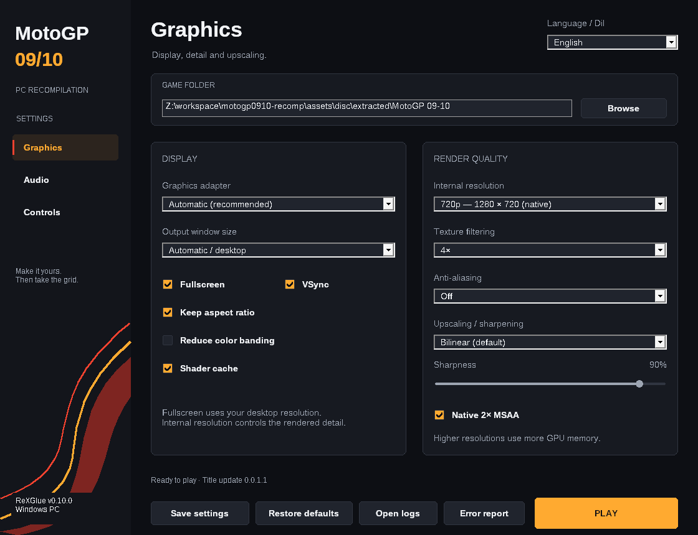
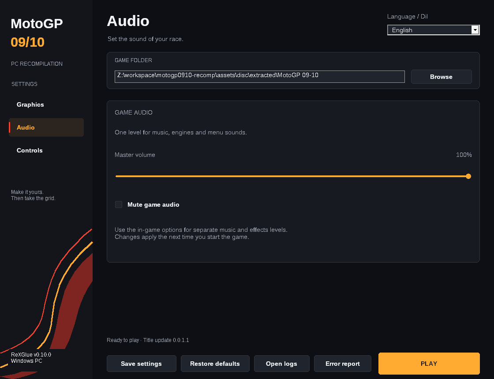
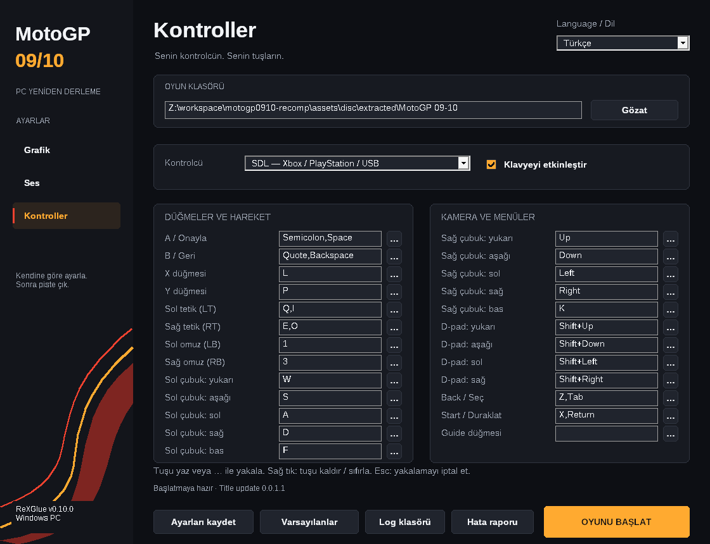

# MotoGP 09/10 Launcher

Open `motogp0910-launcher.exe`, select the game directory and press **PLAY**.
The interface uses charcoal cards with amber/red accents inspired by the MotoGP
09/10 cover palette, an original vector racing ribbon and sidebar navigation.
No reference launcher design, source code or artwork is copied.
The default language is English; **Language / Dil → Türkçe** switches the whole
interface immediately and retains the choice in `motogp0910-launcher.toml`.
File names stay English. No CMD file is required.

## Graphics

| Setting | Runtime behavior |
| --- | --- |
| GPU selection | Automatic or a named DXGI hardware adapter; original adapter indices are retained |
| Native 2× MSAA | Existing SDK native MSAA toggle, enabled by default |
| Output window size | Automatic or 720p through 4K; fullscreen uses the desktop display size |
| Internal resolution | 720p (native), 1440p / 2K, or 4K; exact 1× / 2× / 3× integer scales of the 1280×720 source |
| Bilinear | Original default presentation path |
| AMD FSR 1.0 | Spatial EASU enlargement followed by RCAS sharpening when the rendered image is smaller than the output |
| AMD CAS | Contrast-adaptive sharpening; the SDK also uses CAS when FSR has no enlargement to perform |
| Sharpness | FSR RCAS reduction mapped from 0–100% strength; CAS uses its own 0–1 coefficient |
| Anisotropic filtering | Game setting, off, or 1×–16× |
| Anti-aliasing | Off, FXAA or FXAA Extreme, applied by the real SDK swap post-effect path |
| VSync / aspect ratio / dithering | Actual presentation flags |
| Shader cache | SDK persistent shader storage; changing this does not delete existing cache files |

The package includes a matched modified **ReXGlue v0.10.0** runtime with its
bundled FSR 1 / CAS shader bytecode enabled. Keep both included runtime DLLs;
using the old official DLL makes the FSR setting unavailable. See
[the pinned runtime and reproduction instructions](../third_party/rexglue-runtime/readme.md).
There is no FSR 2/3 or frame generation in this launcher.

FSR 1 is a final-image upscaler; it does not add temporal anti-aliasing or invent
extra detail. For example, 1× native rendering to a 1920×1080 window allows
720p-to-1080p upscaling. At a higher internal rendering scale, there may be
nothing left to upscale. Explicit custom guest video modes in an existing
configuration remain respected. Direct `motogp0910.exe` launch also reads saved
settings and maintains the native source mode when FSR is selected.

A single internal resolution selector replaces the independent X/Y controls.
Selecting a standard preset explicitly saves a native 1280×720 source plus the
matching integer draw scale; output window/fullscreen resolution stays separate.
Existing asymmetric scales and explicit custom source modes are shown as
**Custom** with their dimensions and preserved until a standard preset is chosen.
1080p remains an output resolution, rather than a fictional fractional internal
scale unsupported by this SDK.

## Audio

The master slider controls real output gain, from 0% to 100%, for stereo and
surround. Mute remains available independently. The game's own audio menu
continues to provide its separate music/effects options. Launcher edits apply
on the next game launch.

## Keyboard and controllers

All 25 SDK controller actions appear as directly editable rows in two columns.
Type a binding in its field or click the adjacent **…** to capture a key/chord.
Escape cancels capture. Right-click a field for **Capture key**, **Unbind** and
**Restore action default**. **Restore defaults** resets all launcher-managed
settings. Alternatives remain supported; existing bindings are not silently
rewritten to simpler defaults.

Examples: `Space`, `Return`, `Ctrl+K`, `Shift+Up`, `Q,I` (alternative keys).
Names are case-sensitive, as in the SDK. Unknown names and bare modifiers
that cannot activate in the SDK are rejected before saving. Shared bindings
are allowed intentionally. Mouse button names `LMB`, `RMB`, `MMB` can be entered
as text; keyboard capture records keyboard keys.

SDL supports Xbox, PlayStation and other mapped USB/Bluetooth controllers.
The included `gamecontrollerdb.txt` stays next to the EXE, outside `game/`.
XInput can be selected separately. The game now replaces registered button
glyphs for PlayStation and actual keyboard bindings; see [controller prompts](controller-prompts.md)
for automatic switching and forced-style testing.

## Existing settings and data

`motogp0910.toml` is the actual game configuration. Unknown keys, tables and
custom save/cache roots are retained. Existing keyboard bindings are loaded
into the editor. The original pre-launcher file is backed up once as
`motogp0910.toml.bak`; external edits made while the launcher is open are
protected from accidental overwrite. Settings use atomic replacement.

The standard game layout remains `game/default.xex`, `game/xenondata/` and the
other original disk files. The supported title update is **0.0.1.1**.
`nxeart/` may legitimately be empty. Basic file checks validate the stock XEX
and supported patch/update; they do not promise that every disk asset is valid.
**Open logs** and **Error report** remain available. Reports are created locally
and never uploaded automatically.

## Verification

- Windows game, launcher and runtime DLL pair built successfully.
- 72 launcher checks: numeric launch arguments are verified against actual SDK
  parsers, alongside advanced configuration round trips, SDK flags, preservation,
  validation, Unicode and an actual child process receiving its arguments/CWD.
- 140 runtime checks: FSR 1 EASU/RCAS pass planning and coefficients; native versus
  host video modes; real master gain and converted samples; real MnK driver
  delivering `Ctrl+K` / `Space` to guest A and `Shift+Up` to guest D-pad.
- 50 existing game-code regression checks passed with the new runtime, including
  the race-start callback previously responsible for a crash.
- Production Win32 UI tested under Wine/Xvfb across all three pages, both
  languages and 75% / 100% / 125% / 150% layout scales (24 layouts). Visible
  controls fit without overlaps and localized static text fits its height.
  Presets, all 25 binding fields, capture/cancel/reset, checkbox toggles, actual
  save/reload and preservation of custom render settings are exercised by
  `launcher_layout_probe`.
- The compiled launcher EXE was also driven externally: all pages and both
  languages, advanced settings, real Ctrl+J keyboard capture and saving were
  verified through the production message loop.
- Both Python and PowerShell staging verified against the pinned DLL hashes.

The FSR test uses the real SDK CPU pass planner and a supplied surface size; it
is **not a GPU pixel/shader execution or Windows race-playthrough test**. Native
Windows GPU rendering and listening/playing with the new settings still need
validation on the user's computer. Defaults keep bilinear presentation and
native 720p rendering; higher resolutions and upscaling are opt-in.

The launcher serializes launch arguments using actual TOML node types. Earlier
boolean conversion of numeric nodes could turn scale/volume/sharpness values
into `true`; the new regression checks prevent that.

## Screenshots

These are captures of the actual Windows launcher under Wine, not mockups.

[Graphics, Turkish](screenshots/launcher-graphics-turkish.png) ·
[Audio, Turkish](screenshots/launcher-audio-turkish.png) ·
[Controls, English](screenshots/launcher-controls-english.png)

## Reference projects

[DownpourRecomp](https://github.com/LittleBitUA/DownpourRecomp) was inspected as
an example of useful settings; its launcher design is not copied. FXAA,
anisotropic filtering, internal scale and persistent shader storage are useful
here and have actual v0.10.0 implementations. Downpour-specific UE3 patches,
mouse-camera tuning, its fork's FSR 3 / frame limiter and adaptive-trigger
parameters are not imported as nonfunctional MotoGP controls.

[FIFA Street PC Port](https://github.com/samuelit0davila/fifa-street-pc-port)
was also inspected through its C# launcher sources and published screenshots.
Its GPU adapter selection is useful for multi-GPU systems and was implemented
with native DXGI enumeration, preserving the SDK's adapter indices. Its title-specific
memory/readback compatibility presets and refresh rate/FPS tuning are not
blindly applied to MotoGP. No design/assets/code from either launcher are copied.

Downpour's actual v1.1.8 `PlayDownpour.exe` was also opened under Wine and its
Graphics, Advanced, Controls and Debug pages inspected. Native 2× MSAA is the
additional supported setting retained from that inspection. Its launcher-only
music settings are unrelated to game output volume; MotoGP's slider controls
the actual game's output stage.
